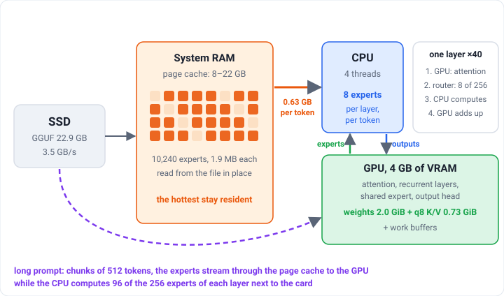

# Strata: Qwen3.6-35B-A3B on a 4 GB GPU

Strata serves **Qwen3.6-35B-A3B** (UD-Q4_K_XL, 22.9 GB) on a PC with a small GPU and a modest RAM budget, through an OpenAI-
and Anthropic-compatible HTTP API on `127.0.0.1:8080`, so that a console agent such as
[pi](https://www.npmjs.com/package/@earendil-works/pi-coding-agent) can work with it locally. It is built and measured on a
laptop with an RTX 3050 Ti (4 GB of VRAM), 31 GB of RAM and an NVMe SSD.

- **About 37 tokens per second** when generating, with 23 GB of RAM free for the page cache; the speed falls gradually, not
  to zero, when memory is short.
- **A 64K-token window** (65,536 by default, 69,391 at most) in 4 GB of VRAM, with a q8 K/V cache.
- **About 200 tokens per second** when reading a prompt, and **checkpoints** of the conversation start, so a new agent
  session reads about 20 tokens instead of 1,500.
- **`tools/spi`**, which runs pi in a sandbox: only the folder you start it in is writable, no `sudo`, no secrets, no network
  except the local server.

## What it needs

- Linux x86-64 with AVX2 (AVX-512 is used when present), an NVIDIA GPU with 4 GB of VRAM or more
- CUDA toolkit 12.x or 13.x, CMake 3.24+, Ninja, a C++20 compiler (clang or gcc)
- Python 3.12+ for the server, in a virtual environment (tested with 3.12 and 3.14)
- 23 GB of disk for the model and 8 GB of free RAM or more, about 23 GB for full speed (see [docs/TUNING.md](docs/TUNING.md))

## Quick start

```sh
tools/setup_venv.sh        # .venv from requirements.lock (hash-pinned)
tools/build.sh             # build/strata-q36 and build/libstrata_kq.so, for the installed GPU
tools/fetch_model.sh       # the pinned GGUF into models/qwen3.6-35b-a3b, size and SHA-256 checked
bin/strata-serve           # the server on http://127.0.0.1:8080, no memory limit: the page cache grows as far as free memory allows
tools/spi                  # pi on that server inside a sandbox: only the current folder is writable (setup: docs/PI.md)
```

The default profile `auto` sets no memory limit: the kernel keeps the model's experts in the page cache while memory is
free and takes them back when another program asks, so the speed (about 37 tokens per second with 23 GB free) falls
gradually instead of the program failing. `bin/strata-serve --profile lean|balanced|fast|max` caps the server's memory
(8, 12, 16 or 22 GB) when a hard budget is needed; `--ram 14G` sets one by hand. A hard cap costs speed, because the
experts that are not in the cache come from the SSD: roughly 10, 17, 25 and 33 tokens per second on the author's laptop,
measured before the AVX-512 kernels (see [docs/TUNING.md](docs/TUNING.md)).
`--context` and `--chunk` change the context window and the prompt chunk, the two things that compete for the 4 GB of
VRAM. Everything the launcher does is visible with `--dry-run`.

## How it fits in a small machine

<p align="center"></p>

The model is a mixture of experts: 256 experts per layer, 8 used per token. The attention, the recurrent layers and the
shared expert (2 GB) sit in VRAM. The routed experts (18.7 GB) are **not** copied anywhere: the CPU computes them straight
from the memory-mapped GGUF with AVX-512 kernels that give the same bits as ggml, so the host holds only the page cache,
which the kernel trims under the memory budget. Long prompts are processed in chunks, and each chunk streams the experts
once through the page cache into the GPU, where the prompt kernels run (int8 matrix multiply), while the CPU computes 96 of
the 256 experts of each layer next to the card. Decoding uses the model's own MTP block for speculative drafting when the
request is greedy.

The K/V cache is stored as 8-bit blocks (ggml's q8_0 layout, 53% of FP16), which is what makes a 64K-token window fit in
the VRAM that is left.
The default window is 65,536 tokens, with about 0.15 GiB of VRAM left (0.49 GiB at 32K): 69,391 is the most this card holds, and
128K needs the K/V cache out of VRAM or at lower precision (see "Long context and video memory" in
[docs/TUNING.md](docs/TUNING.md)). If another program holds VRAM, start with `--context 32768`.

The long-form explanation with charts, in Russian and English, is `docs/index.html`; `docs/TUNING.md` has the tables and `docs/PI.md` the agent setup.

## Layout

| Path | What it is |
| --- | --- |
| `src/qwen35/` | the engine: `q36_engine.cu`, `q36_kernels.cuh`, `q36_main.cpp` |
| `src/kernels/`, `src/prefill/`, `include/` | CPU expert kernels, CUDA kernels, the int8 prompt kernels |
| `third_party/llama.cpp/` | the part of ggml the engine links (CPU backend, quantization, MMQ kernels); see `VERSION.txt` |
| `serve/` | the HTTP server, the web chat page, telemetry and Prometheus collectors |
| `strata_control/`, `strata_cli/` | server helpers (config, tokenizer packs, benchmark client) |
| `tools/` | build, setup, model download, launcher, GGUF and tokenizer tools; `tools/spi` is the pi sandbox |
| `bin/strata-serve` | the server launcher |
| `docs/` | `index.html` (the explanation, Russian and English), `TUNING.md` (tables), `PI.md` (pi setup and safety) |

`tools/vendor_ggml.sh <llama.cpp checkout>` refreshes `third_party/llama.cpp`. A newer ggml may need small changes in
`src/prefill/` (the MMQ entry points change between releases).

## Waiting in pi

The engine keeps checkpoints of its state at the start of a conversation (system prompt and tools), in memory and in
`run/ckpt`, so a new pi session reads about 20 tokens instead of 1,500: a question that waited 21 s now takes 1-6 s. The
first question in a new directory reads the shared start once (9 s with the model in the page cache; the CPU computes
part of the experts next to the card). Details in [docs/PI.md](docs/PI.md) and
[docs/TUNING.md](docs/TUNING.md).

## Metrics

The server keeps request accounting and exposes two endpoints: `GET /metrics` (JSON: the slots and the last requests) and
`GET /metrics/prometheus` (Prometheus text format).

## Tests

```sh
tools/run_tests.sh         # every serve/test_*.py module, one process each
```

## Credits and license

Strata is based on [Strata](https://github.com/Niko1221/Strata) by Niko1221 (MIT), cut down to the Qwen3.6-35B-A3B path and
extended for a small GPU. The vendored ggml sources come from [llama.cpp](https://github.com/ggml-org/llama.cpp) and keep
their own MIT license (`third_party/llama.cpp/LICENSE`). The model is Qwen3.6-35B-A3B by the Qwen team; `tools/fetch_model.sh`
downloads [Unsloth's](https://huggingface.co/unsloth/Qwen3.6-35B-A3B-MTP-GGUF) UD-Q4_K_XL GGUF with the MTP layer. The license
of this repository is in `LICENSE`.
