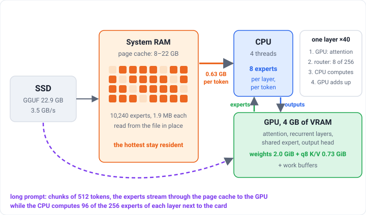

# Strata: making local neural networks fast on modest hardware

Strata is about making neural networks run fast on the hardware at hand, one machine and one model at a time. The first target,
and the only one so far, is **Qwen3.6-35B-A3B** (UD-Q4_K_XL, 22.9 GB, or the smaller UD-IQ4_XS, 18.3 GB with the MTP block) on a
laptop with an RTX 3050 Ti (4 GB of VRAM), 31 GB of RAM and an NVMe SSD. It is served through an OpenAI- and Anthropic-compatible
HTTP API on `127.0.0.1:8080`, so that a console agent such as
[pi](https://www.npmjs.com/package/@earendil-works/pi-coding-agent) can work with it locally. That laptop is simply the machine
at hand: the numbers below are measured on it, and other GPUs and models are meant to follow.

- **About 37 tokens per second** when generating in a short burst on a cool CPU with the turbo boost on and 23 GB of RAM free for
  the page cache; the speed falls gradually, not to zero, when memory is short.
- **Steady speed on a hot laptop.** The CPU of a laptop reaches 80 C within seconds under this load, so the server keeps the
  CPU and the GPU under a temperature limit (80 C by default) and holds the highest CPU frequency at 2.1 GHz. With a cap like that
  the model holds **27 to 33 tokens per second for minutes** instead of 11 to 15 without one (33 is the Q4_K_XL file at 2.1 GHz, the
  lower figures are earlier measurements of the UD-IQ4_XS file at 2.2 GHz; see "Steady speed under a temperature limit").
- **A 64K-token window** (65,536 by default, 69,391 at most) in 4 GB of VRAM, with a q8 K/V cache.
- **About 200 tokens per second** when reading a prompt, and **checkpoints** of the conversation start, so a new agent
  session reads about 20 tokens instead of 1,500.
- **`tools/spi`**, which runs pi in a sandbox: only the folder you start it in and pi's own session folder are writable, no `sudo`,
  no files of yours outside those folders, no secrets, no network of its own: the local server, a read-only `gh` and the public web
  (through a filtering proxy) are reached over sockets. It runs local models only: it starts the UD-IQ4_XS model by default and
  `/model` in pi switches to another local one (docs/PI.md).

## How it fits in a small machine

<p align="center"></p>

The model is a mixture of experts: 256 experts per layer, 8 used per token. The attention, the recurrent layers and the
shared expert (2 GB) sit in VRAM. The routed experts (18.7 GB in the Q4_K_XL file, 15.7 GB in the IQ4_XS file) are **not**
copied anywhere: the CPU computes them straight from the memory-mapped GGUF with AVX-512 kernels (the Q4_K ones give the same bits as
ggml, the IQ3_S and IQ4_XS ones agree with it to about 1e-7), so the host holds only the page cache, which the kernel trims under the memory budget. Long prompts are processed in
chunks, and each chunk streams the experts once through the page cache into the GPU, where the prompt kernels run (int8
matrix multiply), while the CPU computes 96 of the 256 experts of each layer next to the card. Decoding uses the model's own
MTP block for speculative drafting when the request is greedy.

The K/V cache is stored as 8-bit blocks (ggml's q8_0 layout, 53% of FP16), which is what makes a 64K-token window fit in
the VRAM that is left.
The default window is 65,536 tokens, with about 0.15 GiB of VRAM left (0.49 GiB at 32K): 69,391 is the most this card holds, and
128K needs the K/V cache out of VRAM or at lower precision (see "Long context and video memory" in
[docs/TUNING.md](docs/TUNING.md)). If another program holds VRAM, start with `--context 32768`.

The long-form explanation with charts, in Russian and English, is `docs/index.html`; `docs/TUNING.md` has the tables and `docs/PI.md` the agent setup.

## Steady speed under a temperature limit

A burst of 37 tokens per second does not last: the package passes 80 C within seconds. The server therefore reads the CPU and
GPU temperatures and pauses the engine for a part of every half second when they near the limit (`--max-temp`, 80 C by
default). The CPU turbo boost is off by default (`--turbo`), and the server yields the CPU and the disk to other programs
(`--priority background`).

Reading memory barely heats the CPU: four threads read 55.6 GB/s for two minutes with the package at 56 to 61 C. The heat comes
from the arithmetic of the expert kernels, and it falls faster than the speed when the highest CPU frequency, and the voltage
with it, is lowered. A lower cap makes the pauses rarer or removes them. Sustained speed of the UD-IQ4_XS file with MTP, turbo off,
80 C limit, eight requests of 900 tokens after two warm-up requests, one or two runs per row, on the author's laptop:

| setting | tokens/s (median) | peak temperature |
| --- | --- | --- |
| no cap, 2 workers | 11.0 to 14.8 | 77 to 79 C |
| 2.2 GHz, 4 workers | 28.6 and 27.2 (two runs) | 73 and 76 C |
| 2.4 GHz, 4 workers | 28.9 | 78 C |
| 2.6 GHz, 4 workers | 25.3 (the pauses return) | 78 C |
| 2.0 GHz, 6 workers | 28.8 | 74 C |
| 2.2 GHz, 6 workers | 31.1 and 29.8 (two runs) | 77 and 78 C |
| 2.4 GHz, 6 workers | 24.9 (the pauses return) | 80 C |

The default profile `auto` holds the cap by itself: `bin/strata-serve` runs with `--cpu-max-mhz 2100`, 6 workers and no pool spin (2.1 GHz kept the speed
flat in the longest runs, see "Heat and turbo" in docs/TUNING.md), and puts the old limits back when it stops. `--cpu-max-mhz 0` turns the cap off, the profiles with a memory
budget (`lean` to `max`) run without it, and another value suits another CPU: 2100 MHz is about two thirds of this laptop's 3.3 GHz. The
limit files belong to root: without the tmpfiles rule below the server says which files it could not write and runs without the
cap. If the server is killed (`kill -9`) the limits stay low until `tools/cpucap guard` or the next server start puts them back; a timer
that runs the guard every few seconds is described under "Heat and turbo" in docs/TUNING.md.
`tools/cpucap status|set MHZ|reset` does the same by hand. The limits belong to root, so a tmpfiles rule makes them group-writable
once (see "The frequency cap" in [docs/TUNING.md](docs/TUNING.md)); the cap is machine-wide, like the turbo switch. The speed of
one setting differed by up to a quarter between the night and the morning; the repeats of the two best settings came within 5 percent of the first runs.

What did not help, measured on the same laptop: experts held in pinned host memory for the GPU to read over PCIe (0, 16, 32 and
48 slots gave 39.2, 20.1, 14.7 and 12.3 tokens per second in short runs), reading the whole model into the page cache before the
run (11.0 against 12.2), packing the expert bytes for the PCIe link (zstd and xz shrink IQ3_S and IQ4_XS data by only 1 to
2 percent), a package power limit instead of a frequency cap (RAPL PL1 at 22 and 18 W gave 10.2 and 10.4 tokens per second), and
running the whole model on the integrated GPU through llama.cpp with Vulkan (10.8 to 11.3 tokens per second, and 8.8 with the
discrete card added; the package stays at 59 to 65 C).

## The UD-IQ4_XS file

UD-IQ4_XS is 18.3 GB against 22.9 GB: the routed experts are IQ3_S (gate and up) and IQ4_XS or Q6_K (down). The files on Hugging Face
lack the MTP block, so `tools/gguf_graft.py` copies it from the Q4_K_XL file:

```sh
python3 tools/gguf_graft.py --prefix blk.40. --set-u32 qwen35moe.block_count=41 --add-u32 qwen35moe.nextn_predict_layers=1 \
    models/qwen3.6-35b-a3b/Qwen3.6-35B-A3B-UD-IQ4_XS.gguf models/qwen3.6-35b-a3b/Qwen3.6-35B-A3B-UD-Q4_K_XL.gguf \
    models/qwen3.6-35b-a3b/Qwen3.6-35B-A3B-UD-IQ4_XS-mtp.gguf
bin/strata-serve --model models/qwen3.6-35b-a3b/Qwen3.6-35B-A3B-UD-IQ4_XS-mtp.gguf
```

The CPU kernels for these two types read the weights with byte permutes (IQ3_S) and a nibble lookup with VNNI (IQ4_XS), not with
gathers, which are slow on CPUs that have the Downfall microcode. They give the same results as ggml to about 1e-7, and a
micro-benchmark of a whole expert (IQ3_S gate and up, IQ4_XS down) counts 25.1k experts per second against 9.6k for the old path. `--iq-kernels auto|on|off` switches them
(`auto`, the default, turns them on for a file with IQ experts; `STRATA_IQ_VBMI=1` does the same for the engine on its own).

**Which file to run.** Measured on this laptop with the 2.2 GHz cap, 6 workers, no pool spin and MTP 2. Decode is 200 tokens after
a 1.5K-token prompt, the median of four runs; "before" is the engine before the faster CPU kernels of 4 November. Prefill is the time
to process the prompt, the median of the same four runs. The 14K-token prompt is one run per file and engine of the regression
check, with the engine's default of 4 CPU threads; the cap and the pool spin of those runs are not recorded.

| | UD-IQ4_XS | UD-Q4_K_XL |
| --- | --- | --- |
| Decode | 34.25 tokens per second (31.2 before) | 32.2 (27.4 before) |
| Prefill, 1.5K-token prompt | 11.4 s, about 132 tokens per second (14.23 s, about 105, before) | 17.5 s, 86 tokens per second (the same before) |
| Prefill, 14K-token prompt, one run, 4 CPU threads | 95.0 s, 147 tokens per second (103.2 s, 136, before) | 162.0 s, 86 tokens per second (162.9 s, 86, before) |
| Page cache | 18.3 GB | 22.9 GB |
| Package peak temperature | 73 C | 67 C |
| KL divergence from BF16 (published figures) | 0.033 | 0.012 |

IQ4_XS decodes about 6 % faster, which is inside the spread of its runs (29.6 to 36.1), and processes a prompt 1.5 to 1.7 times
faster (1.2 to 1.6 times before the faster kernels). Q4_K_XL, the default, has the smaller loss against BF16 (Unsloth's KLD chart gives IQ4_XS a KLD 2.8 times larger; accuracy
on tasks is not measured for this model) and needs about 23 GB of free RAM for full speed. IQ4_XS needs about 18 GB, so it is the
better file when a browser and chat programs hold part of the memory; without a cap it is also the faster one (14.7 against 12.9
tokens per second).

## What it needs

- Linux x86-64 with AVX2 (AVX-512 is used when present), an NVIDIA GPU with 4 GB of VRAM or more
- CUDA toolkit 12.x or 13.x, CMake 3.24+, Ninja, a C++20 compiler (clang or gcc)
- Python 3.12+ for the server, in a virtual environment (tested with 3.12 and 3.14)
- 23 GB of disk for the model (18.3 GB for IQ4_XS) and 8 GB of free RAM or more, about 23 GB for full speed (see [docs/TUNING.md](docs/TUNING.md))

## Quick start

```sh
tools/setup_venv.sh        # .venv from requirements.lock (hash-pinned)
tools/build.sh             # build/strata-q36 and build/libstrata_kq.so, for the installed GPU
tools/fetch_model.sh       # the pinned GGUF into models/qwen3.6-35b-a3b (SHA-256 checked on download, size only on an existing file)
bin/strata-serve           # the server on http://127.0.0.1:8080, no memory limit: the page cache grows as far as free memory allows
tools/spi                  # in another terminal: pi on that server inside a sandbox (setup: docs/PI.md)
```

The default profile `auto` sets no memory limit: the kernel keeps the model's experts in the page cache while memory is
free and takes them back when another program asks, so the speed (about 30 tokens per second sustained with 23 GB free and the
default frequency cap) falls gradually instead of the program failing. `bin/strata-serve --profile lean|balanced|fast|max` caps the server's memory
(8, 12, 16 or 22 GB) when a hard budget is needed; `--ram 14G` sets one by hand. A hard cap costs speed, because the
experts that are not in the cache come from the SSD: roughly 10, 17, 25 and 33 tokens per second on the author's laptop,
measured before the AVX-512 kernels (see [docs/TUNING.md](docs/TUNING.md)).
`--protect-ram` and `--prewarm` (both on by default; `--no-protect-ram` and `--no-prewarm` turn them off) ask the kernel to
keep the cached model in memory and read it in before the start; the read-in is skipped when free memory is short or the profile reads
with O_DIRECT, and the protection is soft and depends on the control groups above the server (see "Keeping the model in memory" in
[docs/TUNING.md](docs/TUNING.md)).
`--max-temp C` (80 by default, 0 turns it off), `--turbo off|on|keep` (off by default; `tools/turbo on|off|status` does the same on
its own) and `--cpu-max-mhz MHZ` (2100 with the `auto` profile, 0 turns it off) are described in "Heat and turbo" in [docs/TUNING.md](docs/TUNING.md).
`--context` and `--chunk` change the context window and the prompt chunk, the two things that compete for the 4 GB of
VRAM. Everything the launcher does is visible with `--dry-run`.

## Layout

| Path | What it is |
| --- | --- |
| `src/qwen35/` | the engine: `q36_engine.cu`, `q36_kernels.cuh`, `q36_main.cpp` |
| `src/kernels/`, `src/prefill/`, `include/` | CPU expert kernels (including the IQ3_S and IQ4_XS ones), CUDA kernels, the int8 prompt kernels |
| `third_party/llama.cpp/` | the part of ggml the engine links (CPU backend, quantization, MMQ kernels); see `VERSION.txt` |
| `serve/` | the HTTP server, the web chat page, telemetry and Prometheus collectors, the temperature governor (`thermal.py`) and the frequency cap (`cpucap.py`) |
| `strata_control/`, `strata_cli/` | server helpers (config, tokenizer packs, benchmark client) |
| `tools/` | build, setup, model download, launcher, GGUF and tokenizer tools; `tools/spi` is the pi sandbox; `turbo` and `cpucap` switch the CPU limits; `gguf_graft.py` grafts the MTP block; `quant_bench.py` measures a model file |
| `bin/strata-serve` | the server launcher |
| `docs/` | `index.html` (the explanation, Russian and English), `TUNING.md` (tables), `PI.md` (pi setup and safety) |

`tools/vendor_ggml.sh <llama.cpp checkout>` refreshes `third_party/llama.cpp`. A newer ggml may need small changes in
`src/prefill/` (the MMQ entry points change between releases).

## Waiting in pi

The engine keeps checkpoints of its state at the start of a conversation (system prompt and tools), in memory and in
`run/ckpt`, so a new pi session reads about 20 tokens instead of 1,500: a question that waited 21 s now takes 1-6 s. The
first question in a new directory reads the shared start once (9 s with the model in the page cache; the CPU computes
part of the experts next to the card). Details in [docs/PI.md](docs/PI.md) and
[docs/TUNING.md](docs/TUNING.md).

## Measuring a model file

`tools/quant_bench.py` measures the decode speed of the server on one GGUF file at one memory budget. It asks the kernel to drop the
cached pages of the model files before each run (`POSIX_FADV_DONTNEED`, which mapped pages can survive), waits for a cool machine
(with a timeout) and refuses to start while other programs load it or the turbo boost is on, keeps the peak CPU and GPU
temperatures and the answer text, and writes one JSON file per run; `tools/bench_chart.py` and `tools/bench_table.py`
turn the files into charts and tables.

Turn the boost off first (`tools/turbo off`), create the output folder, and give an output file that does not exist yet (or `--force`):

```sh
mkdir -p results
python3 tools/quant_bench.py --model models/qwen3.6-35b-a3b/Qwen3.6-35B-A3B-UD-IQ4_XS-mtp.gguf --label iq4xs --budget none \
    --workers 6 --cpu-max-mhz 2200 --out results/iq4xs_2200.json
```

## Metrics

The server keeps request accounting and exposes two endpoints: `GET /metrics` (JSON: the slots and the last requests) and
`GET /metrics/prometheus` (Prometheus text format).

## Tests

```sh
tools/run_tests.sh         # every serve/test_*.py module, one process each
```

The modules in `tools/` run from that directory with `python3 -m unittest test_quant_bench` (and the same for the others).

## Credits and license

Strata is based on [Strata](https://github.com/Niko1221/Strata) by Niko1221 (MIT), cut down to the Qwen3.6-35B-A3B path and
extended for a small GPU. The vendored ggml sources come from [llama.cpp](https://github.com/ggml-org/llama.cpp) and keep
their own MIT license (`third_party/llama.cpp/LICENSE`). The model is Qwen3.6-35B-A3B by the Qwen team; `tools/fetch_model.sh`
downloads [Unsloth's](https://huggingface.co/unsloth/Qwen3.6-35B-A3B-MTP-GGUF) UD-Q4_K_XL GGUF with the MTP layer. The license
of this repository is in `LICENSE`.
